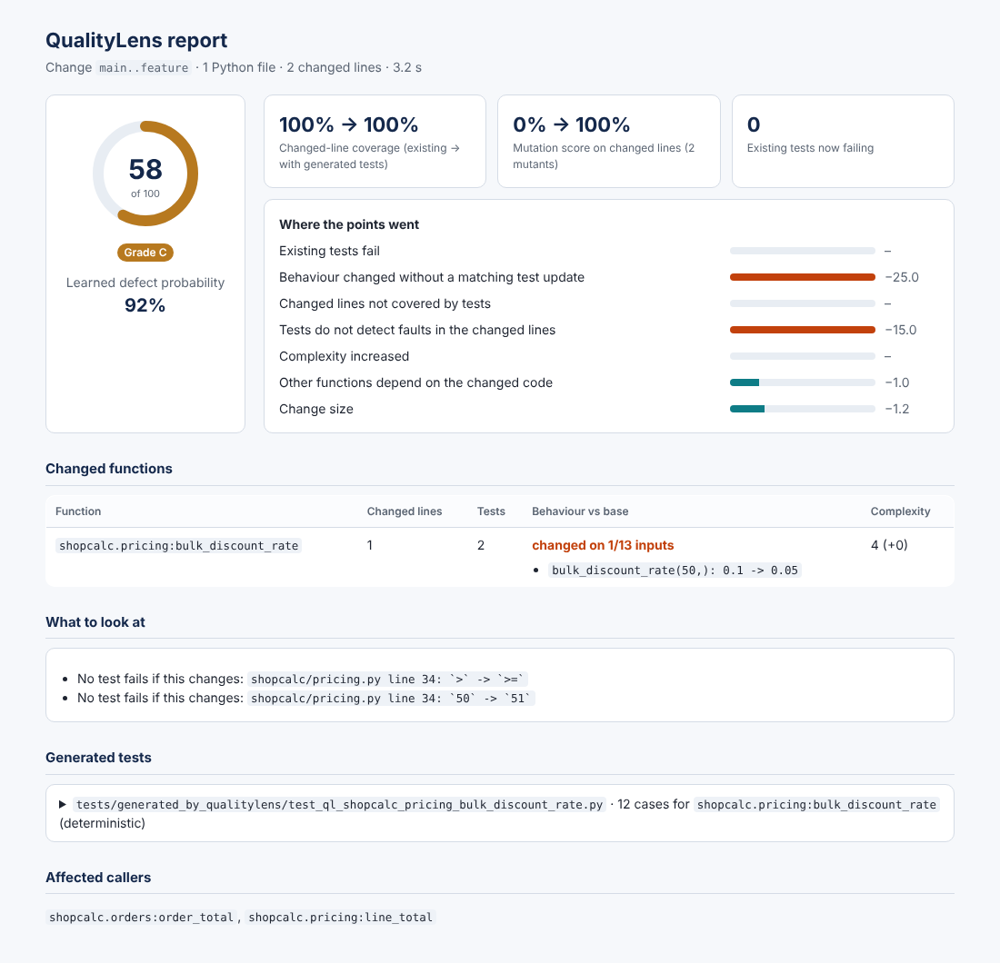
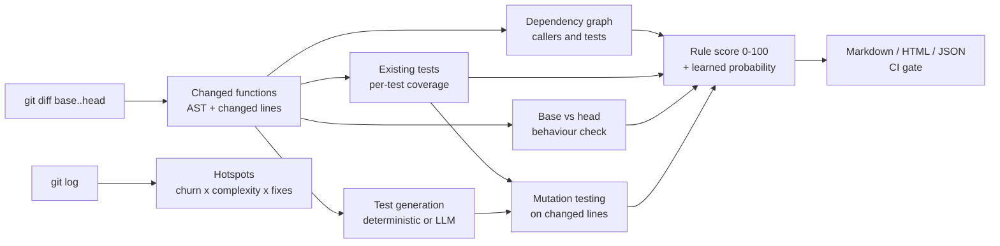
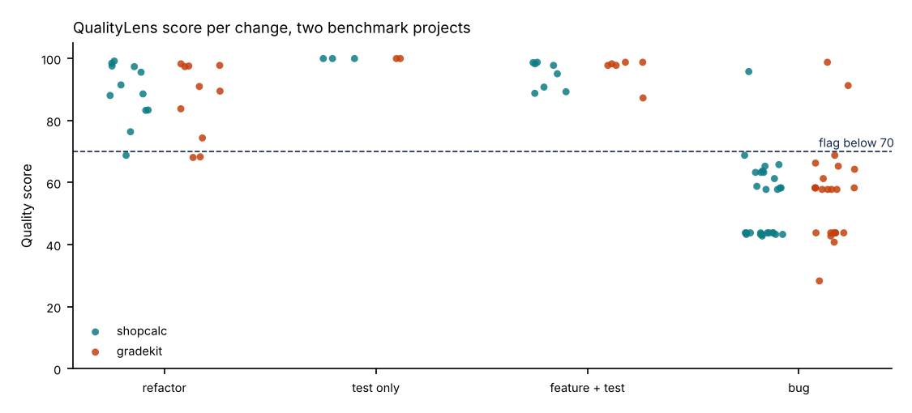
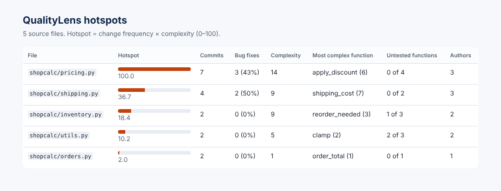

# QualityLens

**AI-assisted test generation and an explainable quality score for every code change.**

QualityLens looks at a Git change (`base..head`), works out which functions it touches and what depends on
them, generates pytest tests for the changed code, measures how well the tests protect the change, and
returns a 0–100 quality score with the reasons behind it, plus a learned defect probability. A second
command mines Git history for **hotspots**: files that change often, are complex and keep needing bug fixes.
It runs as a CLI, as a reusable GitHub Action, or as a CI quality gate.

```bash
python -m qualitylens analyze  --repo . --base origin/main --head HEAD --fail-under 60
python -m qualitylens hotspots --repo . --since "6 months ago"
```



## Why

Line coverage says a line *ran* during the tests, not that a test would *notice* if it were wrong. In the
benchmark below, 41 of 52 bugs passed the existing test suite, and 26 of those sat on lines with 100% coverage.
QualityLens adds signals that coverage misses:

- **Behaviour change vs. base.** Runs the old and new version of each changed function on the same
  generated inputs and shows concrete differences, for example `bulk_discount_rate(50): 0.1 -> 0.05`.
- **Mutation score on the changed lines.** Injects small faults (`>=` to `>`, `50` to `51`, …) only where the
  change happened, and checks whether any test fails.
- **Test-update awareness.** A behaviour change that comes with an updated test covering that function is
  treated as intended. One without a matching test is treated as risky.

## How it works



| Step | What it does |
|---|---|
| Change analysis | Parses the unified diff and maps changed lines to functions with the AST. Changed module constants (e.g. a tax table) are traced to the functions that use them. |
| Dependency analysis | Builds a call graph with `networkx` to find every function and test that can reach the changed code. |
| Per-test coverage | A small pytest plugin based on `sys.settrace` records which lines each test executes. No coverage package needed. |
| Input generation | Type-aware value pools plus **boundary values mined from the code**: constants used in comparisons and their neighbours (49, 50, 51; 74.99, 75.0, 75.01). For membership tests on dictionaries, only the keys are used. |
| Test generation | **Deterministic backend:** executes the function on generated inputs, keeps a small set that maximises line coverage, outcome variety and boundary hits, and writes them as pytest tests. **LLM backend:** any OpenAI-compatible endpoint (e.g. IBM Granite via Ollama). Generated code is screened with AST-based checks for allowed imports and selected forbidden calls, executed, and only passing tests are kept. These checks are not a security sandbox; execute untrusted code only in an isolated environment without secrets or network access. Failing expectations are reported for human review. One repair round on rejection. |
| Code analysis | Cyclomatic complexity and its net change, nesting, length and rule checks (bare/broad except, mutable defaults, `print`/`eval`). Optional LLM review: a finding is kept only if it cites a line the change actually touched. |
| Mutation testing | AST mutants on changed lines only, run against (a) the existing tests that cover the function and (b) existing + generated tests. |
| Rule score | Weighted, explainable risk model (below). Every point lost is attributed to a named signal. |
| Learned model | Class-balanced logistic regression on the same signals, trained on labelled changes. Shipped as JSON, so no scikit-learn is needed at runtime. Reports a defect probability and the signals that drive it. |
| Hotspots | `git log --numstat`: commits, bug-fix commits (by message), churn and authors per file, combined with current complexity and functions no test reaches. |
| Reports | Markdown (PR comment / job summary), self-contained HTML dashboard, JSON. |

### Rule score

| Signal | Weight | Meaning (1 = risky) |
|---|---|---|
| Failing existing tests | 0.30 | A test that passed at base fails at head |
| Untested behaviour change | 0.25 | Share of changed functions whose behaviour changed with no updated test covering them |
| Uncovered changed lines | 0.15 | Changed lines that no existing test executes |
| Weak tests | 0.15 | 1 − mutation score of existing tests on the changed lines |
| Complexity increase | 0.05 | Net cyclomatic complexity added (capped at +5) |
| Dependency impact | 0.05 | Number of transitive callers (capped at 10) |
| Change size | 0.05 | Log-scaled churn |

`quality = 100 × (1 − Σ weight × signal)`. Grades: A ≥ 85, B ≥ 70, C ≥ 55, D ≥ 40, E < 40.
The weights were set by hand from the signal definitions and not fitted. The learned model is the
data-driven check on them (see results).

## Results

The benchmark has **93 labelled changes on two small libraries**: `shopcalc` (order pricing) and `gradekit`
(grading). Each library has partial tests and a **hidden specification test suite** that QualityLens never
sees, which decides the labels. The changes are refactors, test-only changes, intended features with
updated tests, hand-written bugs, and single-line bugs generated at random. `gradekit` was added after the
rule engine was frozen, so it measures generalisation to an unseen project.



| Metric | All (93) | shopcalc (51) | gradekit (42, unseen) |
|---|---|---|---|
| ROC-AUC, rule score | **0.97** | 0.98 | 0.94 |
| Bugs flagged (score < 70) | **49 of 52** | 27 of 28 | 22 of 24 |
| Safe changes flagged | 3 of 41 | 1 of 23 | 2 of 18 |
| Bugs that passed the existing tests, flagged | **38 of 41** | 20 of 21 | 18 of 20 |

| Single signal (AUC, all cases) | Behaviour change | Mutation | Failing tests | Uncovered lines | Churn |
|---|---|---|---|---|---|
| | 0.94 | 0.76 | 0.61 | 0.56 | 0.38 |

**Generated tests:** 1,030 tests, all passing at head. They raised changed-line coverage from **76% to 99%** and
mutation score on changed lines from **40% to 86%**. Median analysis time was 2.4 s per change.

**Learned model** (`benchmark/train_model.py`):

| Evaluation | Learned model | Rule score |
|---|---|---|
| Train on shopcalc, test on gradekit | AUC 0.95, recall 88%, 0 false alarms | AUC 0.94 |
| Train on gradekit, test on shopcalc | AUC 0.96, recall 89%, 0 false alarms | AUC 0.98 |
| 5-fold CV × 10 repeats | 0.96 ± 0.05 | 0.97 ± 0.04 |

The learned model does not beat the hand-set weights. It does generalise across projects without false
alarms, and its coefficients rank the signals in the same order (behaviour change > failing tests > weak
tests). That supports the hand weights rather than replacing them.

**Held-out bugs.** After the tool was frozen, a fresh set of generated bugs was created with a new seed,
excluding every bug used before. The rule score flagged **15 of 15** (7 shopcalc, 8 gradekit) and the
learned model 14 of 15. The set is small, so read it as a sanity check.

**Development honesty.** On `shopcalc` I fixed three tool issues the first benchmark run exposed: a
docstring-only edit was treated as a whole-function change, missing mutants were double-counted, and
dictionary values crowded comparison thresholds out of the input pool. One `gradekit` label was wrong
because the hidden spec never tested a D-grade student. I fixed the spec, not the tool.

**Known misses (not tuned away):**
- Bankers' rounding instead of half-up (B04): the inputs contain no half-cent values.
- `mean` rounded to 1 instead of 2 decimals (GB12): the list inputs are too small to show it.
- "D counts as a fail" (GB11): the generator does not aim for specific output classes, such as a D student.
- Refactors of untested functions (R10, GR06, GR08) score 68–69 because their changed lines have no tests.

Reproduce: `python benchmark/run_benchmark.py`, then `--holdout`, then `cd benchmark && python train_model.py`.

## Hotspots



`qualitylens hotspots` ranks files by change frequency × complexity (0–100). It shows bug-fix commits,
authors and the functions that no test reaches, so you can see where new tests pay off first. The example
in [`examples/hotspots.md`](examples/hotspots.md) and the screenshot come from a small scripted demo history
(12 commits by placeholder authors on the shopcalc code), not from a real project.

## Quick start

```bash
git clone https://github.com/rushipatil1318-boop/qualitylens && cd qualitylens
pip install -e .            # pytest + networkx
python -m pytest            # 20 tests
python -m qualitylens analyze --repo /path/to/repo --base main --head HEAD --out qualitylens-report
```

Output: `report.md`, `report.html`, `report.json` and `generated_tests/`.

### LLM backend (e.g. IBM Granite on Ollama)

```bash
export QL_LLM_BASE_URL=http://localhost:11434/v1
export QL_LLM_MODEL=granite3.3:8b
python -m qualitylens analyze --backend llm --llm-review --base main --head HEAD
```

The LLM backend is covered by tests with a mocked client: safety rejection, repair round, keeping only
passing tests, and dropping review findings with invented line numbers. The benchmark numbers use the
deterministic backend, so they are reproducible without a model.

### GitHub Action

```yaml
- uses: actions/checkout@v4
  with: { fetch-depth: 0 }
- uses: rushipatil1318-boop/qualitylens@main
  with:
    fail-under: "60"
```

The action writes the report to the job summary, exposes `score` as an output, and fails the check below
the threshold. A full workflow is in [`examples/quality-gate.yml`](examples/quality-gate.yml).

## Limitations

- Python only. Best on functions that take plain values. Methods and functions that need complex objects get no generated tests yet.
- Deterministic tests are *characterization tests*: they record current behaviour. If the change is a bug, they lock it in.
  That is why the behaviour check against base is reported separately and weighted heavily.
- The benchmarks are synthetic and small (two libraries, 93 changes). The next step is real project
  history: replay commits that were later fixed and check whether QualityLens would have flagged them.
- The hotspot bug-fix count relies on commit messages ("fix", "bug", "hotfix", …).

## Project layout

```
qualitylens/      gitutils, codemap (AST), deps (call graph), pytest_plugin (per-test coverage), inputs,
                  testgen (+ testgen_llm, llm_client), differential, mutation, review, score, learned,
                  history (hotspots), report, report_html, pipeline, cli; models/risk_model.json
tests/            20 pytest tests (unit + end-to-end on temporary git repos)
benchmark/        projects/{shopcalc,gradekit} (code, partial tests, hidden spec, labelled cases),
                  run_benchmark.py, train_model.py, results/
examples/         sample report (md + html), generated test file, hotspots, workflow
action.yml        reusable GitHub Action
```

MIT licence. Author: Rushikesh Sanjay Patil.
